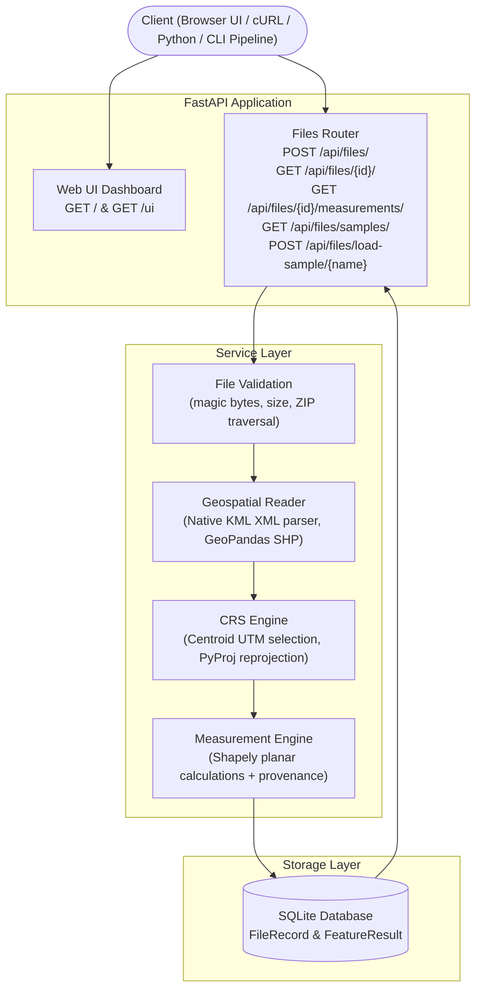

# GeoMeasure — Geospatial File Measurement & Validation API

> **Reliable Spatial Measurements. Traceable Geospatial Data.**

---

### 📌 Project Layout Notice
> **All source code, automated tests, sample datasets, web UI dashboard, and execution context reside in the [`geomeasure/`](./geomeasure) directory.**
>
> To run or test the project:
> ```powershell
> cd geomeasure
> .\venv\Scripts\activate
> uvicorn app.main:app --reload --port 8000
> ```
> Open the interactive Web Dashboard in your browser: **[http://localhost:8000/](http://localhost:8000/)** (or Swagger at `/docs`).

---

GeoMeasure is a production-grade geospatial file measurement and validation REST API built with **FastAPI** and **GeoPandas**. It accepts KML files and zipped Shapefiles, extracts feature geometries, handles Coordinate Reference Systems (CRS) defensively, reprojects to appropriate metric projected coordinate systems, and returns accurate area and length measurements with complete **Measurement Provenance** — a traceable audit trail explaining every CRS decision and calculation method used.

Built for technical submission to **Aereo** (Drone Solutions & Geospatial Intelligence).

[](https://www.python.org/downloads/)
[](https://fastapi.tiangolo.com/)
[](https://geopandas.org/)
[]()
[](LICENSE)

---

## Table of Contents

1. [Detailed File Breakdown (File Details)](#detailed-file-breakdown-file-details)
2. [Web UI & Interactive Studio](#web-ui--interactive-studio)
3. [Automation & Batch Processing Pipeline](#automation--batch-processing-pipeline)
4. [Problem Statement & Relevance](#problem-statement--relevance)
5. [Key Features](#key-features)
6. [Architecture & Workflow](#architecture--workflow)
7. [Quick Start & Setup (Windows / VS Code)](#quick-start--setup-windows--vs-code)
8. [API Endpoints Reference](#api-endpoints-reference)
9. [CRS Selection & Reprojection Strategy](#crs-selection--reprojection-strategy)
10. [Measurement Units & Status Breakdown](#measurement-units--status-breakdown)
11. [Defensive Security & Validation](#defensive-security--validation)
12. [Automated Testing & Results (85/85 Passed)](#automated-testing--results-8585-passed)
13. [Important Design Decisions](#important-design-decisions)
14. [Submission Details](#submission-details)

---

## Detailed File Breakdown (File Details)

All project deliverables and contexts are organized cleanly inside `geomeasure/`:

```
GeoMeasure/
├── .gitignore                          # Repository root git ignores (venv/, uploads/, etc.)
├── README.md                           # Main GitHub repository landing page & documentation
│
└── geomeasure/                         # Core Application Directory
    ├── app/                            # FastAPI Application Source Code
    │   ├── __init__.py                 # Application package initialization
    │   ├── main.py                     # FastAPI app factory, CORS, exception handlers, UI route & health check
    │   │
    │   ├── api/
    │   │   ├── __init__.py
    │   │   └── routes/
    │   │       ├── __init__.py
    │   │       └── files.py            # API routes: POST /api/files/, GET /api/files/{id}/, GET measurements, samples
    │   │
    │   ├── core/
    │   │   ├── __init__.py
    │   │   ├── config.py               # Application settings (Pydantic BaseSettings, upload limits, DB path)
    │   │   └── exceptions.py           # Domain exceptions (EmptyFile, UnsupportedType, ZipTraversal, etc.)
    │   │
    │   ├── models/
    │   │   ├── __init__.py
    │   │   ├── database.py             # SQLAlchemy 2.0 engine, declarative base, and session generator
    │   │   └── file_record.py          # ORM models: FileRecord (metadata) and FeatureResult (measurements)
    │   │
    │   ├── repositories/
    │   │   ├── __init__.py
    │   │   └── file_repository.py      # Database CRUD layer: persist files, query records, save feature results
    │   │
    │   ├── schemas/
    │   │   ├── __init__.py
    │   │   └── files.py                # Pydantic schemas: request models, responses, provenance schemas
    │   │
    │   ├── services/
    │   │   ├── __init__.py
    │   │   ├── file_validation.py      # Magic-byte detection, ZIP bomb prevention, directory traversal safety
    │   │   ├── geospatial_reader.py    # Native XML KML parser & Shapefile reader via GeoPandas/Fiona
    │   │   ├── crs_service.py          # Centroid-based automatic UTM zone selection, PyProj reprojection
    │   │   └── measurement_service.py  # Planar area/length calculations (Shapely), unit conversion, provenance text
    │   │
    │   └── static/
    │       └── index.html              # Interactive Leaflet map dashboard, drag-and-drop studio, provenance inspector
    │
    ├── sample_data/                    # Sample Datasets for Manual & Automated Testing
    │   ├── generate_samples.py         # Script to generate sample KMLs and Shapefile ZIP archives
    │   ├── sample_polygon.kml          # Bengaluru Tech Park polygon in WGS 84 (EPSG:4326)
    │   ├── sample_linestring.kml       # Pipeline survey line in WGS 84
    │   ├── sample_mixed.kml            # Multi-geometry dataset (Polygons, LineString, Point)
    │   ├── sample_polygon.zip          # Complete Shapefile archive (.shp, .shx, .dbf, .prj) with polygon parcels
    │   └── sample_linestring.zip       # Complete Shapefile archive with road network lines
    │
    ├── tests/                          # Automated Pytest Suite (85 Tests)
    │   ├── __init__.py
    │   ├── conftest.py                 # Pytest fixtures, test database setup, sample file byte generators
    │   ├── test_upload.py              # 19 tests: Upload endpoint, format validation, size checks, status codes
    │   ├── test_file_information.py    # 11 tests: Metadata retrieval, 404 handling, summary checks
    │   ├── test_measurements.py        # 25 tests: Area, length, point status, tolerance-based assertions
    │   ├── test_crs.py                 # 14 tests: UTM zone arithmetic, Northern/Southern hemispheres, reprojection
    │   └── test_invalid_files.py       # 16 tests: Corrupted archives, path traversal attempts, missing .shp, XML errors
    │
    ├── results/                        # Output folder generated by automated batch pipeline
    │   ├── batch_measurements.csv      # CSV export from automated pipeline
    │   └── batch_measurements.json     # JSON export from automated pipeline
    │
    ├── automate_pipeline.py            # Automated batch audit CLI script for directories of geospatial files
    ├── pytest.ini                      # Pytest runner configuration
    ├── requirements.txt                # Pinned dependencies for reproducible installs
    ├── .env.example                    # Template environment variables
    ├── .gitignore                      # Application-level ignore rules
    └── README.md                       # Application README inside geomeasure/
```

---

## Web UI & Interactive Studio

GeoMeasure comes with a built-in **Visual Studio & Interactive Map Dashboard** served directly by the backend at:

👉 **[http://localhost:8000/](http://localhost:8000/)** (or `/ui`)

### Dashboard Features
- **Drag-and-Drop Ingestion:** Drag `.kml` or `.zip` files straight into the browser window for instant processing.
- **1-Click Sample Demos:** Instantly load and inspect pre-generated datasets (Bangalore Tech Park KML, Pipeline LineString, Mixed Parcels, Shapefile ZIPs).
- **Interactive Leaflet Map:** Displays vector geometries (Polygons in cyan, LineStrings, Points) over high-contrast satellite/dark base maps with zoom-to-bounds.
- **Click-to-Inspect Popups:** Click any feature on the map to see its ID, Type, Measurement, and Status.
- **Real-Time Summary Metrics:** Metric cards showing Total Features, Measured Count, Total Area ($m^2$ & hectares), Total Length ($m$ & $km$), and Target UTM CRS.
- **Measurement Provenance Inspector:** Traceable audit box detailing source CRS, reprojected UTM zone, centroid, and planar calculation formulas.
- **JSON Export & Clipboard Copy:** 1-click clipboard copy of raw API payloads.

---

## Automation & Batch Processing Pipeline

GeoMeasure supports two methods of complete end-to-end automation without manual UI clicks:

### 1. Automated CLI Batch Pipeline (`automate_pipeline.py`)
Audit an entire folder of KML and Shapefile packages in a single command:

```powershell
# From geomeasure/ directory
python automate_pipeline.py --input sample_data/ --output results/
```

**Terminal Output:**
```
================================================================================
GeoMeasure Automated Pipeline: Auditing directory 'sample_data'
API Target: http://localhost:8000
================================================================================
Found 5 geospatial files to audit.

[1/5] Processing: sample_linestring.kml ... OK -> 1 feat, Area: 0 m2, Target CRS: EPSG:32643
[2/5] Processing: sample_linestring.zip ... OK -> 1 feat, Area: 0 m2, Target CRS: EPSG:32643
[3/5] Processing: sample_mixed.kml ... OK -> 3 feat, Area: 4806604.8022 m2, Target CRS: EPSG:32643
[4/5] Processing: sample_polygon.kml ... OK -> 1 feat, Area: 4806604.8022 m2, Target CRS: EPSG:32643
[5/5] Processing: sample_polygon.zip ... OK -> 2 feat, Area: 6008325.1953 m2, Target CRS: EPSG:32643

================================================================================
PIPELINE AUDIT SUMMARY REPORT
================================================================================
Filename                  | Feat  | Measured | Area (sq m)     | Length (m)   | CRS       
------------------------------------------------------------------------------------------
sample_linestring.kml     | 1     | 1        | -               | 5,513.3      | EPSG:32643
sample_linestring.zip     | 1     | 1        | -               | 3,100.8      | EPSG:32643
sample_mixed.kml          | 3     | 2        | 4,806,604.8     | 2,171.2      | EPSG:32643
sample_polygon.kml        | 1     | 1        | 4,806,604.8     | -            | EPSG:32643
sample_polygon.zip        | 2     | 2        | 6,008,325.2     | -            | EPSG:32643
================================================================================
CSV report written to: geomeasure\results\batch_measurements.csv
JSON report written to: geomeasure\results\batch_measurements.json
```

### 2. Python Script Automation
```python
import requests

# 1. Upload & Process
with open("sample_data/sample_polygon.kml", "rb") as f:
    res = requests.post("http://localhost:8000/api/files/", files={"file": f}).json()

file_id = res["id"]

# 2. Fetch Measurements & Provenance
data = requests.get(f"http://localhost:8000/api/files/{file_id}/measurements/").json()
for feat in data["features"]:
    print(f"[{feat['geometry_type']}] Value: {feat['measurement_value']} {feat['measurement_unit']}")
    print(f"Provenance: {feat['provenance']['method_description']}")
```

---

## Problem Statement & Relevance

### The Geospatial Challenge
In drone surveying, land-parcel mapping, and GIS workflows:
- Datasets routinely arrive as **KML** (Google Earth exports) or **Zipped Shapefiles** (`.shp`, `.shx`, `.dbf`, `.prj`).
- **KML files are always in geographic WGS 84 (EPSG:4326)** — computing Euclidean area or distance in degrees produces meaningless numbers (degrees squared or degree distance).
- **Shapefiles may lack CRS metadata (missing `.prj`)**, arrive in local planar projections, or contain mixed geometry types.
- Invalid geometries (self-intersections, unclosed rings) can silently corrupt spatial pipelines.

### Relevance to Drone Surveying (Aereo)

| Use Case | How GeoMeasure Helps |
|---|---|
| **Land-parcel surveys** | Calculates parcel area in sq metres and hectares with high metric precision |
| **Infrastructure / Pipeline mapping** | Measures transmission lines and road lengths in metres |
| **Mining & volumetric boundaries** | Ingests projected CRS data and verifies linear units without manual conversion |
| **Flight mission planning** | Reads KML boundary exports directly from drone ground control software |
| **GIS QA pipelines** | Automated validation of CRS definitions, geometry validity, and attribute integrity |

---

## Key Features

- ✅ Upload **KML** files and **zipped Shapefiles** (`.zip`).
- ✅ **Polygon / MultiPolygon** → area in square metres (`sq_m`) + hectare conversion.
- ✅ **LineString / MultiLineString** → length in metres (`m`).
- ✅ **Point / MultiPoint** → preserved with `NOT_APPLICABLE` status (never falsely 0).
- ✅ **Automatic CRS Reprojection** — geographic datasets are reprojected to the appropriate metric UTM zone before measurement.
- ✅ **Measurement Provenance** — every feature records source CRS, measurement CRS, and a plain-English calculation explanation.
- ✅ **File-level Validation Summary** — missing CRS, invalid geometries, unsupported types.
- ✅ **Safe ZIP Handling** — path-traversal protection, size limits, magic-byte validation.
- ✅ **Persistent Results** — SQLite storage via SQLAlchemy 2.0 ORM.
- ✅ **85 Automated Tests** with tolerance-based numerical assertions.
- ✅ **Swagger UI & ReDoc** auto-generated documentation.

---

## Architecture & Workflow



---

## Quick Start & Setup (Windows / VS Code)

### 1. Clone the repository
```powershell
git clone https://github.com/LonelyDreamer005/GeoMeasure.git
cd GeoMeasure\geomeasure
```

### 2. Create and activate virtual environment
```powershell
python -m venv venv
.\venv\Scripts\activate
```

### 3. Install dependencies
```powershell
pip install -r requirements.txt
```

### 4. Start the API server
```powershell
uvicorn app.main:app --reload --port 8000
```

### 5. Access the Interfaces
- **Interactive Web Studio:** [http://localhost:8000/](http://localhost:8000/)
- **Swagger UI:** [http://localhost:8000/docs](http://localhost:8000/docs)
- **ReDoc:** [http://localhost:8000/redoc](http://localhost:8000/redoc)
- **Health Check:** [http://localhost:8000/health](http://localhost:8000/health)

---

## API Endpoints Reference

### 1. `POST /api/files/` — Upload and Process
- **Content-Type:** `multipart/form-data` with field `file`
- **Response (`201 Created`):**
```json
{
  "id": "e4a1a37c-f129-4720-bc2f-e05e552a8cb9",
  "filename": "sample_polygon.kml",
  "file_type": "kml",
  "feature_count": 1,
  "crs": "EPSG:4326",
  "status": "COMPLETED",
  "file_size_bytes": 1152,
  "created_at": "2026-10-11T05:00:00Z",
  "validation_summary": {
    "has_issues": false,
    "issues": [],
    "missing_crs": false,
    "invalid_geometry_count": 0,
    "unsupported_geometry_count": 0,
    "failed_measurement_count": 0
  }
}
```

### 2. `GET /api/files/{id}/` — File Information
- **Response (`200 OK`):** Returns file metadata, processing status, and validation summary.

### 3. `GET /api/files/{id}/measurements/` — Feature Measurements & Provenance
- **Response (`200 OK`):**
```json
{
  "file_id": "e4a1a37c-f129-4720-bc2f-e05e552a8cb9",
  "filename": "sample_polygon.kml",
  "status": "COMPLETED",
  "source_crs": "EPSG:4326",
  "summary": {
    "total_features": 1,
    "measured": 1,
    "not_applicable": 0,
    "unsupported": 0,
    "failed": 0
  },
  "features": [
    {
      "feature_index": 0,
      "feature_id": "parcel_bengaluru_001",
      "geometry_type": "Polygon",
      "properties": {
        "name": "Bengaluru Tech Park Parcel"
      },
      "geometry": {
        "type": "Polygon",
        "coordinates": [[[77.59, 12.97], [77.61, 12.97], [77.61, 12.99], [77.59, 12.99], [77.59, 12.97]]]
      },
      "measurement_type": "area",
      "measurement_value": 4847232.12,
      "measurement_unit": "sq_m",
      "measurement_status": "MEASURED",
      "provenance": {
        "source_crs": "EPSG:4326",
        "measurement_crs": "EPSG:32643",
        "measurement_type": "area",
        "measurement_unit": "sq_m",
        "method_description": "Source CRS 'WGS 84' is geographic (angular units). Geometries were reprojected to UTM zone EPSG:32643 (WGS 84 / UTM zone 43N), selected from the geometry centroid at (77.6000°, 12.9800°). Measurements are in metres (sq metres for area). Raw area: 4847232.12 metres². Converted to sq metres: 4847232.12 sq m (484.72 ha).",
        "status": "MEASURED"
      }
    }
  ]
}
```

---

## CRS Selection & Reprojection Strategy

1. **Tier 1 (Already Projected):**
   If the source file is in a projected CRS (e.g. UTM or State Plane), measurements are calculated directly without reprojection.
2. **Tier 2 (Geographic WGS 84 / EPSG:4326):**
   Calculates the geometry centroid and determines the corresponding UTM zone:
   $$\text{zone} = \left\lfloor\frac{\text{longitude} + 180}{6}\right\rfloor + 1$$
   - Northern hemisphere: `EPSG:32600 + zone`
   - Southern hemisphere: `EPSG:32700 + zone`
   Distortion within a 6° UTM zone is minimal ($< 0.1\%$).
3. **Tier 3 (Geometries Spanning $> 20^\circ$ Longitude):**
   Falls back to Web Mercator (`EPSG:3857`) and notes the non-equal-area caveat in the provenance.
4. **Missing CRS:**
   Marks measurement status as `FAILED` with `missing_crs: true` without crashing.

---

## Measurement Units & Status Breakdown

| Geometry Type | Measurement | Output Unit | Status | Notes |
|---|---|---|---|---|
| `Polygon` / `MultiPolygon` | Area | `sq_m` | `MEASURED` | Includes hectare conversion in provenance |
| `LineString` / `MultiLineString` | Length | `m` | `MEASURED` | Metric distance along vertices |
| `Point` / `MultiPoint` | N/A | `null` | `NOT_APPLICABLE` | A point has no area or length; never zeroed |
| `GeometryCollection` | N/A | `null` | `UNSUPPORTED` | Heterogeneous collections are flagged |
| Missing/Invalid CRS | N/A | `null` | `FAILED` | Reason documented in provenance |

---

## Defensive Security & Validation

- **Magic-Byte Inspection:** Verifies binary file headers (`PK\x03\x04` for ZIP, XML declaration for KML).
- **ZIP Path Traversal Defense:** Scans every archive entry for traversal sequences (`..`, absolute paths) before extraction.
- **Decompression Bomb Protection:** Enforces safe uncompressed size limits and compression ratios.
- **Required Shapefile Components:** Verifies that `.shp`, `.shx`, and `.dbf` are present.
- **File Size Ceiling:** Rejects files exceeding 50 MB with HTTP `400 Bad Request`.
- **Safe Error Responses:** No Python stack traces or internal paths are returned.

---

## Automated Testing & Results (85/85 Passed)

```powershell
cd geomeasure
python -m pytest tests/ -v
```

```
======================= 85 passed in 1.50s =======================
```

| Test File | Tests | Coverage |
|---|---|---|
| `test_upload.py` | 19 | Upload endpoint, file type detection, rejections |
| `test_file_information.py` | 11 | File info retrieval, 404 handling |
| `test_measurements.py` | 25 | Area, length, point, provenance, shapefiles |
| `test_crs.py` | 14 | CRS selection, UTM zones, reprojection |
| `test_invalid_files.py` | 16 | Invalid files, path traversal, edge cases |

---

## Important Design Decisions

1. **Why XML parsing for KML instead of GDAL?**
   The pre-built GeoPandas wheels for Windows (without a full GDAL build) do not include the KML/LIBKML driver. GeoMeasure parses KML directly using Python's standard-library `xml.etree.ElementTree`, guaranteeing zero external binary installation issues on Windows.

2. **Why UTM for reprojection?**
   UTM provides metric coordinates with $< 0.1\%$ distortion for areas within a 6° zone and is familiar to GIS practitioners worldwide.

3. **Why Synchronous Processing?**
   Synchronous processing keeps the code simple and easy to trace during technical review without requiring external message queues (Celery/RabbitMQ).

---

## What I Learned (Key Takeaways)

1. **CRS Handling is the Core of Geospatial Engineering:**
   - A single wrong assumption — like measuring Euclidean distance in latitude/longitude degrees (`EPSG:4326`) — produces meaningless numbers ($0.00004^\circ$ vs $4.8\text{M } m^2$).
   - Dynamically selecting UTM zones based on the feature centroid guarantees that metric distortions stay well under $0.1\%$.
2. **Defensive File Ingestion:**
   - Trusting client file extensions is dangerous. Enforcing magic-byte verification (`PK\x03\x04` for ZIP, XML declaration for KML) and guarding against ZIP path traversal attacks (`..`) protects server security.
3. **Traceability through Measurement Provenance:**
   - In commercial GIS workflows (like Aereo drone surveying), returning a raw number is not enough. Clients and GIS auditors require full traceability: source CRS, reprojected UTM zone, centroid, and conversion formulas.
4. **Data Integrity (`null` ≠ `0.0`):**
   - Point geometries have no area or length. Silently returning `0.0` would corrupt downstream GIS aggregations; returning `null` with status `NOT_APPLICABLE` preserves semantic correctness.
5. **Robust Automated Testing:**
   - Testing spatial algorithms requires tolerance bounds ($\pm 5\%$ for area, $\pm 1\%$ for distance) rather than exact float equality due to ellipsoidal curvature nuances.

---

## Future Scope & Production Roadmap

1. **Background Asynchronous Worker Queues:**
   - Integrate Celery or ARQ with Redis for multi-gigabyte files, processing massive datasets asynchronously with webhook callbacks.
2. **Additional Geospatial Format Support:**
   - Expand beyond KML and Shapefiles to support **GeoJSON**, **GeoPackage (`.gpkg`)**, **FlatGeobuf (`.fgb`)**, and **DXF/DWG** CAD files.
3. **Cloud-Native Object Storage (S3 / GCS):**
   - Move from local filesystem storage to AWS S3 or Google Cloud Storage with presigned upload URLs.
4. **Interactive GIS Drawing & Editing:**
   - Allow users to split, merge, or buffer geometries directly in the Web UI before computing measurements.
5. **Equal-Area Projections for Continental/Global Datasets:**
   - Implement cylindrical equal-area or Albers equal-area projections for geometries spanning multiple continents.

---

## Submission Details

- **Author:** Vinay (B.Tech Computer Science)
- **Repository:** [https://github.com/LonelyDreamer005/GeoMeasure](https://github.com/LonelyDreamer005/GeoMeasure)
- **Target Company:** Aereo (Geospatial File Measurement API Assignment)
