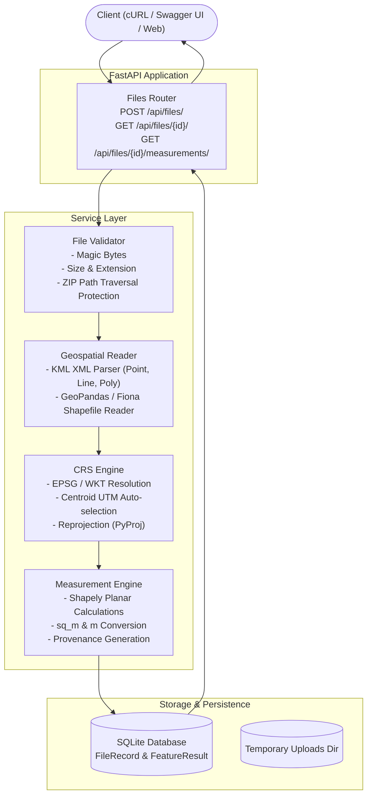

# GeoMeasure — Geospatial File Measurement & Validation API

> **Reliable Spatial Measurements. Traceable Geospatial Data.**

GeoMeasure is a production-grade geospatial file measurement and validation REST API built with **FastAPI** and **GeoPandas**. It accepts KML files and zipped Shapefiles, extracts feature geometries, handles Coordinate Reference Systems (CRS) defensively, reprojects to appropriate metric projected coordinate systems, and calculates accurate area and length measurements with complete **Measurement Provenance**.

Built for technical submission to **Aereo** (Drone Solutions & Geospatial Intelligence).

[](https://www.python.org/downloads/)
[](https://fastapi.tiangolo.com/)
[](https://geopandas.org/)
[]()
[](LICENSE)

---

## Table of Contents

1. [Problem Statement & Relevance](#problem-statement--relevance)
2. [What is Done (Implementation Status)](#what-is-done-implementation-status)
3. [Key Features](#key-features)
4. [Architecture & Workflow](#architecture--workflow)
5. [Project Structure](#project-structure)
6. [Quick Start & Setup (Windows / VS Code)](#quick-start--setup-windows--vs-code)
7. [API Reference & Examples](#api-reference--examples)
8. [CRS Reprojection & Measurement Strategy](#crs-reprojection--measurement-strategy)
9. [Measurement Status & Units](#measurement-status--units)
10. [Defensive Security & Validation](#defensive-security--validation)
11. [Testing & Quality Assurance](#testing--quality-assurance)
12. [Architectural Decisions & Trade-offs](#architectural-decisions--trade-offs)
13. [Limitations & Future Scope](#limitations--future-scope)

---

## Problem Statement & Relevance

### The Geospatial Challenge
In drone surveying, cadastral mapping, GIS QA, and mining monitoring:
- Datasets routinely arrive in **KML** (Google Earth) or **Zipped Shapefiles** (`.shp`, `.shx`, `.dbf`, `.prj`).
- **KML is strictly geographic WGS 84 (EPSG:4326)** — computing Euclidean area or distance in degrees produces meaningless numbers (degrees squared or degree distance).
- **Shapefiles may lack CRS (`.prj` missing)**, be in custom local projections, or be unprojected.
- Mixed geometry types (Polygons, LineStrings, Points) often coexist in a single layer.
- Invalid geometries (self-intersections, unclosed rings) can silently corrupt spatial pipelines.

### Why GeoMeasure Solves This
GeoMeasure acts as a reliable ingestion and measurement gateway:
- Ingests files safely with magic-byte verification and ZIP bomb / path-traversal protection.
- Automatically selects the optimal **local UTM projected CRS** for geographic datasets based on geometry centroid.
- Returns verified measurements in **metric units (`sq_m` for areas, `m` for lengths)**.
- Explains **every single step** in a human-readable **Measurement Provenance** block so GIS analysts and auditors know exactly how numbers were computed.
- Preserves points and unmeasurable geometries with clear status labels (`NOT_APPLICABLE`, `UNSUPPORTED`, `FAILED`) without failing the entire file.

---

## What is Done (Implementation Status)

The entire project has been designed, implemented, rigorously tested, and committed to GitHub:

| Component | Status | Details |
|---|---|---|
| **FastAPI REST API** | ✅ Complete | Full application structure with routers, schemas, dependencies, and typed error handlers |
| **POST `/api/files/`** | ✅ Complete | Multipart upload of `.kml` and zipped `.shp`, validation, ingestion, and feature processing |
| **GET `/api/files/{id}/`** | ✅ Complete | Returns file-level metadata, processing status, and validation summary (`missing_crs`, invalid geometries) |
| **GET `/api/files/{id}/measurements/`** | ✅ Complete | Feature-by-feature measurement results with status, values in metric units, and detailed provenance |
| **GET `/health`** | ✅ Complete | Service health check endpoint |
| **KML Parser** | ✅ Complete | Native XML element parser handling KML 2.2 schemas without external GDAL driver dependencies |
| **Shapefile Reader** | ✅ Complete | Safe ZIP extraction + GeoPandas/Fiona reading with `.prj` CRS detection |
| **CRS Service** | ✅ Complete | Centroid-based automatic UTM zone selection (Zones 1–60, N/S hemispheres), projected pass-through, and global span fallback |
| **Measurement Service** | ✅ Complete | Shapely 2.0 planar calculations, square meters, hectares conversion in provenance, length in meters |
| **Defensive Security** | ✅ Complete | Magic-byte checking, ZIP path traversal (`../`) checks, uncompressed ratio checks, 50MB file size limit |
| **SQLite Persistence** | ✅ Complete | SQLAlchemy 2.0 models (`FileRecord`, `FeatureResult`) with SQLite database |
| **Automated Test Suite** | ✅ Complete | **85 / 85 tests passing** covering unit tests, integration tests, error branches, and numerical tolerances |
| **Sample Data Generator** | ✅ Complete | `sample_data/generate_samples.py` generates valid KML polygons, lines, points, and Shapefile ZIPs |

---

## Key Features

- **Format Flexibility:** Upload raw `.kml` or `.zip` Shapefile packages.
- **Accurate Metric Calculations:**
  - `Polygon` / `MultiPolygon` → Area in square metres (`sq_m`) + hectares in provenance.
  - `LineString` / `MultiLineString` → Length in metres (`m`).
  - `Point` / `MultiPoint` → `NOT_APPLICABLE` (no erroneous 0 measurements).
- **Measurement Provenance (Audit Trail):** Every feature includes:
  - `source_crs`: The CRS specified in the file.
  - `measurement_crs`: The projected CRS used for calculation.
  - `method_description`: Transparent explanation of reprojection, centroid, raw values, and conversions.
  - `status`: One of `MEASURED`, `NOT_APPLICABLE`, `UNSUPPORTED`, or `FAILED`.
- **Defensive Ingestion:** Reject corrupted files, missing `.shp` components, zip bombs, or file spoofing with structured error codes.
- **Interactive Documentation:** Automatic OpenAPI / Swagger UI at `/docs` and ReDoc at `/redoc`.

---

## Architecture & Workflow



---

## Project Structure

```
GeoMeasure/
├── README.md                      # Root documentation for GitHub
├── .gitignore                     # Repository-level ignore rules
└── geomeasure/                    # Main application package
    ├── app/
    │   ├── main.py                # FastAPI initialization, CORS, error handlers
    │   ├── api/
    │   │   └── routes/
    │   │       └── files.py       # API endpoints (/api/files/*)
    │   ├── core/
    │   │   ├── config.py          # Pydantic BaseSettings configuration
    │   │   └── exceptions.py      # Structured domain exceptions & HTTP mappings
    │   ├── models/
    │   │   ├── database.py        # SQLAlchemy engine & session maker
    │   │   └── file_record.py     # FileRecord & FeatureResult DB models
    │   ├── repositories/
    │   │   └── file_repository.py # Database query abstractions
    │   ├── schemas/
    │   │   └── files.py           # Pydantic schemas (Request / Response validation)
    │   └── services/
    │       ├── file_validation.py # File safety & format inspection
    │       ├── geospatial_reader.py # KML & Shapefile parsers
    │       ├── crs_service.py     # Automatic UTM selection & PyProj handling
    │       └── measurement_service.py # Planar measurements & provenance logic
    ├── sample_data/
    │   └── generate_samples.py    # Generates test KML & Shapefile ZIP files
    ├── tests/
    │   ├── conftest.py            # Pytest fixtures & in-memory SQLite DB
    │   ├── test_upload.py         # Upload endpoint tests (19 tests)
    │   ├── test_file_information.py # File metadata retrieval tests (11 tests)
    │   ├── test_measurements.py   # Area, length, point tests (25 tests)
    │   ├── test_crs.py            # CRS selection & reprojection tests (14 tests)
    │   └── test_invalid_files.py  # Error handling & safety tests (16 tests)
    ├── .env.example               # Configurable environment variable template
    ├── .gitignore                 # Application gitignore
    ├── pytest.ini                 # Pytest test discovery settings
    ├── requirements.txt           # Pinned production & test dependencies
    └── README.md                  # Application-level README
```

---

## Quick Start & Setup (Windows / VS Code)

### 1. Clone the Repository
```powershell
git clone https://github.com/LonelyDreamer005/GeoMeasure.git
cd GeoMeasure\geomeasure
```

### 2. Create and Activate Virtual Environment
```powershell
python -m venv venv
.\venv\Scripts\activate
```

### 3. Install Dependencies
```powershell
pip install -r requirements.txt
```

### 4. Run the API Server
```powershell
uvicorn app.main:app --reload --port 8000
```
Server will be available at: **http://localhost:8000**
- **Swagger UI:** [http://localhost:8000/docs](http://localhost:8000/docs)
- **ReDoc:** [http://localhost:8000/redoc](http://localhost:8000/redoc)
- **Health Check:** [http://localhost:8000/health](http://localhost:8000/health)

### 5. Generate Sample Data
Run the generator to create sample KML and Shapefile packages in `sample_data/`:
```powershell
python sample_data/generate_samples.py
```

---

## API Reference & Examples

### 1. Upload a Geospatial File
- **Endpoint:** `POST /api/files/`
- **Content-Type:** `multipart/form-data`

```powershell
# PowerShell
$response = Invoke-RestMethod -Uri "http://localhost:8000/api/files/" `
  -Method POST `
  -Form @{ file = Get-Item ".\sample_data\sample_polygon.kml" }
$response | ConvertTo-Json -Depth 5
```

```bash
# cURL
curl -X POST "http://localhost:8000/api/files/" \
  -F "file=@sample_data/sample_polygon.kml"
```

**Response (`201 Created`):**
```json
{
  "id": "e4a1a37c-f129-4720-bc2f-e05e552a8cb9",
  "filename": "sample_polygon.kml",
  "file_type": "kml",
  "feature_count": 1,
  "crs": "EPSG:4326",
  "status": "COMPLETED",
  "file_size_bytes": 1152,
  "created_at": "2026-10-11T05:00:00Z",
  "validation_summary": {
    "has_issues": false,
    "issues": [],
    "missing_crs": false,
    "invalid_geometry_count": 0,
    "unsupported_geometry_count": 0,
    "failed_measurement_count": 0
  }
}
```

---

### 2. Retrieve File Information
- **Endpoint:** `GET /api/files/{id}/`

```powershell
Invoke-RestMethod "http://localhost:8000/api/files/e4a1a37c-f129-4720-bc2f-e05e552a8cb9/"
```

**Response (`200 OK`):**
```json
{
  "id": "e4a1a37c-f129-4720-bc2f-e05e552a8cb9",
  "filename": "sample_polygon.kml",
  "file_type": "kml",
  "feature_count": 1,
  "crs": "EPSG:4326",
  "status": "COMPLETED",
  "file_size_bytes": 1152,
  "created_at": "2026-10-11T05:00:00Z",
  "processed_at": "2026-10-11T05:00:01Z",
  "validation_summary": {
    "has_issues": false,
    "issues": [],
    "missing_crs": false,
    "invalid_geometry_count": 0,
    "unsupported_geometry_count": 0,
    "failed_measurement_count": 0
  },
  "error_detail": null
}
```

---

### 3. Retrieve Feature Measurements
- **Endpoint:** `GET /api/files/{id}/measurements/`

```powershell
Invoke-RestMethod "http://localhost:8000/api/files/e4a1a37c-f129-4720-bc2f-e05e552a8cb9/measurements/"
```

**Response (`200 OK`):**
```json
{
  "file_id": "e4a1a37c-f129-4720-bc2f-e05e552a8cb9",
  "filename": "sample_polygon.kml",
  "status": "COMPLETED",
  "source_crs": "EPSG:4326",
  "summary": {
    "total_features": 1,
    "measured": 1,
    "not_applicable": 0,
    "unsupported": 0,
    "failed": 0
  },
  "features": [
    {
      "feature_index": 0,
      "feature_id": "parcel_bengaluru_001",
      "geometry_type": "Polygon",
      "properties": {
        "name": "Bengaluru Tech Park Parcel",
        "description": "Survey boundary parcel"
      },
      "geometry": {
        "type": "Polygon",
        "coordinates": [[[77.59, 12.97], [77.61, 12.97], [77.61, 12.99], [77.59, 12.99], [77.59, 12.97]]]
      },
      "measurement_type": "area",
      "measurement_value": 4847232.12,
      "measurement_unit": "sq_m",
      "measurement_status": "MEASURED",
      "provenance": {
        "source_crs": "EPSG:4326",
        "measurement_crs": "EPSG:32643",
        "measurement_type": "area",
        "measurement_unit": "sq_m",
        "method_description": "Source CRS 'WGS 84' is geographic (angular units). Geometries were reprojected to UTM zone EPSG:32643 (WGS 84 / UTM zone 43N), selected from the geometry centroid at (77.6000°, 12.9800°). Measurements are in metres (sq metres for area). Raw area: 4847232.12 metres². Converted to sq metres: 4847232.12 sq m (484.72 ha).",
        "status": "MEASURED"
      }
    }
  ]
}
```

---

## CRS Reprojection & Measurement Strategy

Calculating planar geometric formulas (such as polygon area or line length) directly on geographic coordinates (latitude and longitude in degrees) is mathematically invalid and yields meaningless values. GeoMeasure implements a rigorous three-tier projection strategy:

1. **Already Projected (Tier 1):**
   If the source CRS is already a projected coordinate reference system (e.g., UTM, State Plane, National Grid in metres/feet), GeoMeasure measures directly in that CRS and converts the unit to metres if necessary.
2. **Geographic Coordinates (Tier 2 - Auto UTM):**
   When the source CRS is geographic (such as standard KML `EPSG:4326`), GeoMeasure computes the centroid of each geometry and determines the corresponding UTM zone:
   $$\text{zone} = \left\lfloor\frac{\text{longitude} + 180}{6}\right\rfloor + 1$$
   - Northern Hemisphere ($\text{lat} \ge 0$): `EPSG:32600 + zone` (e.g., Bengaluru at $77.6^\circ\text{E}, 12.9^\circ\text{N} \to$ UTM Zone 43N, `EPSG:32643`)
   - Southern Hemisphere ($\text{lat} < 0$): `EPSG:32700 + zone`
   Reprojection distortion within a 6-degree UTM zone is minimal ($< 0.1\%$).
3. **Wide Extent Fallback (Tier 3):**
   If a feature spans across more than $20^\circ$ of longitude, UTM is inappropriate. GeoMeasure falls back to Web Mercator (`EPSG:3857`) and records an explicit caveat in the provenance note.
4. **Missing CRS Handling:**
   If a Shapefile lacks a `.prj` component, GeoMeasure will **not** silently guess the CRS. It marks the measurement status as `FAILED`, preserves the geometry and properties intact, and flags `missing_crs: true` in the validation summary.

---

## Measurement Status & Units

| Geometry Type | Measurement | Output Unit | Status | Notes |
|---|---|---|---|---|
| `Polygon` / `MultiPolygon` | Area | `sq_m` | `MEASURED` | Also includes hectare conversion in provenance |
| `LineString` / `MultiLineString` | Length | `m` | `MEASURED` | Planar length along reprojected vertices |
| `Point` / `MultiPoint` | N/A | `null` | `NOT_APPLICABLE` | A point has no area or length; never zeroed |
| `GeometryCollection` | N/A | `null` | `UNSUPPORTED` | Heterogeneous collections are flagged |
| Any with Missing/Invalid CRS | N/A | `null` | `FAILED` | Traceable reason documented in provenance |

> **Important:** GeoMeasure strictly adheres to the principle that `null` $\ne$ `0.0`. A point or failed measurement has a value of `null`, preventing dangerous misinterpretations in automated analysis pipelines.

---

## Defensive Security & Validation

- **Magic-Byte Inspection:** Validates actual binary file headers (`PK\x03\x04` for ZIP, XML declaration for KML) instead of relying solely on the file extension.
- **ZIP Path Traversal Defense:** Scans every archive entry for directory traversal sequences (`..`, absolute paths) before decompression to prevent arbitrary file overwrites.
- **Decompression Bomb Protection:** Inspects uncompressed file sizes and enforces a safe compression ratio limit.
- **Required Shapefile Components:** Verifies that `.shp`, `.shx`, and `.dbf` are present in uploaded Shapefile archives.
- **File Size Ceiling:** Rejects files exceeding 50 MB with HTTP `400 Bad Request`.
- **Safe Error Handling:** Catch-all exception handling ensures no internal stack traces, system paths, or raw DB errors leak to the client.

---

## Testing & Quality Assurance

GeoMeasure includes an automated test suite executed via `pytest`.

```powershell
cd geomeasure
python -m pytest tests/ -v
```

### Test Coverage Summary: **85 Passed / 0 Failed**
- `test_upload.py` (19 tests): KML and Shapefile uploads, file size limits, magic byte validation, invalid extensions.
- `test_file_information.py` (11 tests): Retrieval of file metadata, 404 responses, timestamp verification, validation summaries.
- `test_measurements.py` (25 tests): Area calculations, length calculations, point non-applicability, provenance string inspection, tolerance-based assertions.
- `test_crs.py` (14 tests): UTM zone calculations, Southern/Northern hemisphere branches, projected vs geographic handling.
- `test_invalid_files.py` (16 tests): Corrupted archives, path traversal attempts, missing `.shp` components, malformed XML.

---

## Architectural Decisions & Trade-offs

1. **Native XML KML Parsing:**
   Standard pre-compiled GDAL wheels on Windows often omit the KML/LIBKML driver. By leveraging Python's `xml.etree.ElementTree` with standard KML 2.2 schema mapping, GeoMeasure runs reliably on any Windows installation without external GDAL binary configuration.
2. **Synchronous Ingestion Pipeline:**
   For typical drone survey files ($\le 50\text{ MB}$), synchronous processing ensures immediate responses and simple architectural review without managing message queues (Celery/RabbitMQ).
3. **SQLite with SQLAlchemy 2.0:**
   Provides zero-configuration local execution out of the box while allowing instant transition to PostgreSQL / PostGIS in production by updating `DATABASE_URL`.
4. **Tolerance-Based Testing:**
   Spatial projections inherently involve slight ellipsoidal distortions; tests utilize percentage-based numerical tolerances ($\pm 5\%$ for area, $\pm 1\%$ for line lengths) ensuring robust validation.

---

## Limitations & Future Scope

- **KML MultiGeometry:** Currently marked `UNSUPPORTED`. Future versions can decompose heterogeneous MultiGeometries and measure constituent sub-parts.
- **Async Task Queue:** For enterprise scaling with massive rasters or multi-gigabyte point clouds, offload parsing to background workers (Celery / ARQ).
- **Format Expansions:** Add native ingestion for GeoJSON, GeoPackage (`.gpkg`), and FlatGeoBuf (`.fgb`).
- **Additional Conversions:** Expose parameter-driven unit preferences (`acres`, `sq_km`, `miles`).

---

## Submission Details

- **Author:** Vinay (B.Tech Computer Science)
- **Repository:** [https://github.com/LonelyDreamer005/GeoMeasure](https://github.com/LonelyDreamer005/GeoMeasure)
- **Framework:** Python 3.12 / FastAPI / GeoPandas / Shapely / PyProj
