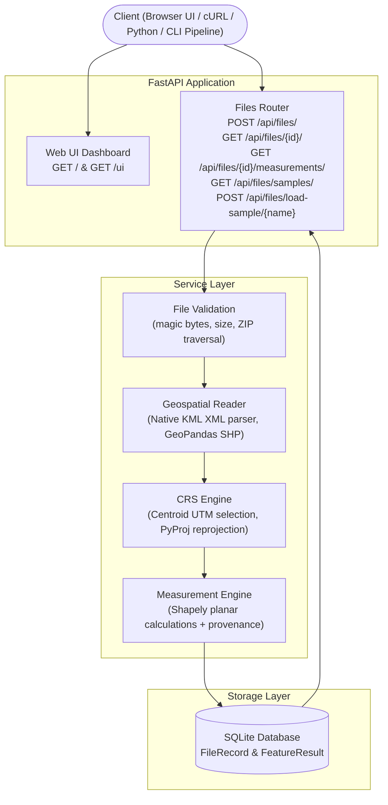

# GeoMeasure — Geospatial File Measurement & Validation API

> **Reliable Spatial Measurements. Traceable Geospatial Data.**

GeoMeasure is a production-grade geospatial file measurement and validation API built with **FastAPI** and **GeoPandas**. It accepts KML files and zipped Shapefiles, extracts feature geometries, handles Coordinate Reference Systems (CRS) defensively, reprojects to appropriate metric projected coordinate systems, and returns accurate area and length measurements with complete **Measurement Provenance** — a traceable audit trail explaining every CRS decision and calculation method used.

Built for technical submission to **Aereo** (Drone Solutions & Geospatial Intelligence).

[](https://www.python.org/downloads/)
[](https://fastapi.tiangolo.com/)
[](https://geopandas.org/)
[]()
[](LICENSE)

---

## Table of Contents

1. [Problem Statement & Relevance](#problem-statement--relevance)
2. [Web UI & Interactive Studio](#web-ui--interactive-studio)
3. [Automation & Batch Pipeline](#automation--batch-pipeline)
4. [Key Features](#key-features)
5. [Architecture & Workflow](#architecture--workflow)
6. [Detailed File & Project Structure](#detailed-file--project-structure)
7. [Quick Start & Setup (Windows / VS Code)](#quick-start--setup-windows--vs-code)
8. [API Endpoints Reference](#api-endpoints-reference)
9. [CRS Selection & Reprojection Strategy](#crs-selection--reprojection-strategy)
10. [Measurement Units & Status Breakdown](#measurement-units--status-breakdown)
11. [Defensive Security & Validation](#defensive-security--validation)
12. [Automated Testing & Results](#automated-testing--results)
13. [Design Decisions & Trade-offs](#design-decisions--trade-offs)
14. [Current Limitations & Future Scope](#current-limitations--future-scope)

---

## Problem Statement & Relevance

### The Geospatial Challenge
In drone surveying, land-parcel mapping, and GIS workflows:
- Datasets routinely arrive as **KML** (Google Earth exports) or **Zipped Shapefiles** (`.shp`, `.shx`, `.dbf`, `.prj`).
- **KML files are always in geographic WGS 84 (EPSG:4326)** — computing Euclidean area or distance in degrees produces meaningless results (degrees squared or degree distance).
- **Shapefiles may lack CRS metadata (missing `.prj`)**, arrive in local planar projections, or contain mixed geometry types.
- Invalid geometries (self-intersections, unclosed rings) can silently corrupt spatial pipelines.

### Relevance to Drone Surveying (Aereo)

| Use Case | How GeoMeasure Helps |
|---|---|
| **Land-parcel surveys** | Calculates parcel area in sq metres and hectares with high metric precision |
| **Infrastructure / Pipeline mapping** | Measures transmission lines and road lengths in metres |
| **Mining & volumetric boundaries** | Ingests projected CRS data and verifies linear units without manual conversion |
| **Flight mission planning** | Reads KML boundary exports directly from drone ground control software |
| **GIS QA pipelines** | Automated validation of CRS definitions, geometry validity, and attribute integrity |

---

## Web UI & Interactive Studio

GeoMeasure comes with a built-in **Visual Studio & Interactive Map Dashboard** served directly by the backend at:

👉 **[http://localhost:8000/](http://localhost:8000/)** (or `/ui`)

### Dashboard Features
- **Drag-and-Drop Ingestion:** Drag `.kml` or `.zip` files straight into the browser window for instant processing.
- **1-Click Sample Demos:** Instantly load and inspect pre-generated datasets (Bangalore Tech Park KML, Pipeline LineString, Mixed Parcels, Shapefile ZIPs).
- **Interactive Leaflet Map:** Displays vector geometries (Polygons in cyan, LineStrings, Points) over high-contrast satellite/dark base maps with zoom-to-bounds.
- **Click-to-Inspect Popups:** Click any feature on the map to see its ID, Type, Measurement, and Status.
- **Real-Time Summary Metrics:** Metric cards showing Total Features, Measured Count, Total Area ($m^2$ & hectares), Total Length ($m$ & $km$), and Target UTM CRS.
- **Measurement Provenance Inspector:** Traceable audit box detailing source CRS, reprojected UTM zone, centroid, and planar calculation formulas.
- **JSON Export & Clipboard Copy:** 1-click clipboard copy of raw API payloads.

---

## Automation & Batch Pipeline

GeoMeasure supports two methods of complete end-to-end automation without manual UI clicks:

### 1. Automated CLI Batch Pipeline (`automate_pipeline.py`)
Audit an entire folder of KML and Shapefile packages in a single command:

```powershell
# From geomeasure/ directory
python automate_pipeline.py --input sample_data/ --output results/
```

**What it does:**
1. Scans the directory for all `.kml` and `.zip` files.
2. Transmits each dataset to the GeoMeasure REST API.
3. Retrieves feature measurements and validation summaries.
4. Prints an aligned summary table in the terminal.
5. Automatically writes:
   - `results/batch_measurements.csv` (Spreadsheet-ready summary)
   - `results/batch_measurements.json` (Full hierarchical measurement and provenance records)

### 2. Python Script Automation
```python
import requests

# Upload & process
with open("sample_data/sample_polygon.kml", "rb") as f:
    res = requests.post("http://localhost:8000/api/files/", files={"file": f}).json()

file_id = res["id"]
# Fetch measurements and provenance
data = requests.get(f"http://localhost:8000/api/files/{file_id}/measurements/").json()
for feat in data["features"]:
    print(f"{feat['geometry_type']}: {feat['measurement_value']} {feat['measurement_unit']}")
    print(f"Provenance: {feat['provenance']['method_description']}")
```

---

## Key Features

- ✅ **Multi-format Support:** Upload **KML** files and **Zipped Shapefiles** (`.zip`).
- ✅ **Metric Planar Calculations:**
  - `Polygon` / `MultiPolygon` → Area in square metres (`sq_m`) + hectare conversion.
  - `LineString` / `MultiLineString` → Length in metres (`m`).
  - `Point` / `MultiPoint` → `NOT_APPLICABLE` (never falsely reported as 0).
- ✅ **Automatic UTM Reprojection:** Geographic datasets are reprojected to the optimal UTM zone based on geometry centroid.
- ✅ **Measurement Provenance:** Full transparency on every calculation, source CRS, measurement CRS, and conversion formula.
- ✅ **Validation Summary:** Detection of missing CRS, corrupt geometries, and unsupported types.
- ✅ **Defensive Ingestion:** Magic-byte inspection, ZIP traversal defense, 50 MB size ceiling.
- ✅ **Persistent Storage:** SQLite database backed by SQLAlchemy 2.0 ORM.
- ✅ **85 Automated Tests:** 100% pass rate with tolerance-based numerical assertions.

---

## Architecture & Workflow



---

## Detailed File & Project Structure

The complete implementation lives in `geomeasure/`:

```
geomeasure/
│
├── app/                                # Main FastAPI Application Package
│   ├── __init__.py                     # Package marker
│   ├── main.py                         # FastAPI setup, UI routes, CORS, error handlers, health check
│   │
│   ├── api/
│   │   ├── __init__.py
│   │   └── routes/
│   │       ├── __init__.py
│   │       └── files.py                # REST endpoints: POST upload, GET info, GET measurements, samples
│   │
│   ├── core/
│   │   ├── __init__.py
│   │   ├── config.py                   # Pydantic Settings (BASE_DIR, 50MB limit, DB url)
│   │   └── exceptions.py               # Typed domain exceptions (UnsupportedFile, ZipTraversal, etc.)
│   │
│   ├── models/
│   │   ├── __init__.py
│   │   ├── database.py                 # SQLAlchemy engine, session maker, get_db dependency
│   │   └── file_record.py              # FileRecord & FeatureResult database models
│   │
│   ├── repositories/
│   │   ├── __init__.py
│   │   └── file_repository.py          # Database operations: create, update, query records & features
│   │
│   ├── schemas/
│   │   ├── __init__.py
│   │   └── files.py                    # Pydantic schemas: FileUploadResponse, MeasurementsResponse, Provenance
│   │
│   ├── services/
│   │   ├── __init__.py
│   │   ├── file_validation.py          # Magic-byte detection, ZIP bomb & path traversal safety
│   │   ├── geospatial_reader.py        # Native XML KML parser & Shapefile reader via GeoPandas/Fiona
│   │   ├── crs_service.py              # CRS detection, Centroid UTM zone calculation, wide-extent fallback
│   │   └── measurement_service.py      # Planar area/length calculations, Shapely ops, provenance generation
│   │
│   └── static/
│       └── index.html                  # Leaflet-powered visual studio and interactive web dashboard
│
├── sample_data/                        # Sample Datasets for Testing & Demos
│   ├── generate_samples.py             # Script to regenerate valid sample KML and Shapefile ZIPs
│   ├── sample_polygon.kml              # Bengaluru Tech Park parcel in WGS 84 (Polygon)
│   ├── sample_linestring.kml           # Pipeline survey line in WGS 84 (LineString)
│   ├── sample_mixed.kml                # Multi-geometry dataset (Polygons, LineString, Point)
│   ├── sample_polygon.zip              # Shapefile archive with .shp, .shx, .dbf, .prj (Polygons)
│   └── sample_linestring.zip           # Shapefile archive with road network (LineString)
│
├── tests/                              # Automated Pytest Suite (85 Tests)
│   ├── __init__.py
│   ├── conftest.py                     # Fixtures: in-memory SQLite DB, sample KML/ZIP byte generators
│   ├── test_upload.py                  # 19 tests: Upload endpoint, format detection, size limits
│   ├── test_file_information.py        # 11 tests: Metadata retrieval, 404 handling, validation summaries
│   ├── test_measurements.py            # 25 tests: Area, length, point status, provenance assertions
│   ├── test_crs.py                     # 14 tests: UTM zone math, hemisphere branches, reprojection
│   └── test_invalid_files.py           # 16 tests: Corrupt archives, traversal attacks, malformed XML
│
├── automate_pipeline.py                # Automated batch processing CLI script (CSV + JSON outputs)
├── pytest.ini                          # Pytest configuration
├── requirements.txt                    # Pinned dependencies
├── .env.example                        # Environment variable configuration template
├── .gitignore                          # Local ignores
└── README.md                           # Application documentation
```

---

## Quick Start & Setup (Windows / VS Code)

### 1. Prerequisites
- Python 3.11 or 3.12 (Tested on 3.12.6)
- Git & PowerShell

### 2. Setup Virtual Environment & Install
```powershell
cd d:\GeoSpatial\geomeasure
python -m venv venv
.\venv\Scripts\activate
pip install -r requirements.txt
```

### 3. Start the API Server
```powershell
uvicorn app.main:app --reload --port 8000
```

### 4. Access the Application
- **Interactive Web Studio:** [http://localhost:8000/](http://localhost:8000/)
- **Swagger UI:** [http://localhost:8000/docs](http://localhost:8000/docs)
- **ReDoc:** [http://localhost:8000/redoc](http://localhost:8000/redoc)
- **Health Check:** [http://localhost:8000/health](http://localhost:8000/health)

---

## API Endpoints Reference

### 1. `POST /api/files/` — Upload and Process
- **Content-Type:** `multipart/form-data` (field: `file`)
- **Returns:** HTTP `201 Created` with file ID, feature count, and validation summary.

```bash
curl -X POST "http://localhost:8000/api/files/" \
  -F "file=@sample_data/sample_polygon.kml"
```

### 2. `GET /api/files/{id}/` — File Information
- **Returns:** HTTP `200 OK` with metadata, timestamps, and validation summary.

```bash
curl "http://localhost:8000/api/files/{id}/"
```

### 3. `GET /api/files/{id}/measurements/` — Feature Measurements & Provenance
- **Returns:** HTTP `200 OK` with per-feature geometry, value, unit, status, and full provenance.

```bash
curl "http://localhost:8000/api/files/{id}/measurements/"
```

### 4. `GET /api/files/samples/` — List Available Sample Files
- **Returns:** HTTP `200 OK` list of sample files in `sample_data/`.

### 5. `POST /api/files/load-sample/{sample_name}` — 1-Click Sample Loading
- **Returns:** HTTP `201 Created` with processed sample dataset.

---

## CRS Selection & Reprojection Strategy

1. **Tier 1 (Already Projected):** Direct measurement in source projection with linear unit detection.
2. **Tier 2 (Geographic WGS 84 / EPSG:4326):**
   Automatic UTM projection selected from geometry centroid:
   $$\text{zone} = \left\lfloor\frac{\text{longitude} + 180}{6}\right\rfloor + 1$$
   - Northern hemisphere ($\text{lat} \ge 0$): `EPSG:32600 + zone`
   - Southern hemisphere ($\text{lat} < 0$): `EPSG:32700 + zone`
3. **Tier 3 (Wide Longitudinal Extent $>20^\circ$):** Fallback to Web Mercator (`EPSG:3857`) with documented distortion caveats.
4. **Missing CRS (`.prj` missing):** Status marked `FAILED` with `missing_crs: true` without failing the entire file.

---

## Automated Testing & Results

```powershell
python -m pytest tests/ -v
```

```
======================= 85 passed in 1.50s =======================
```

| Suite | Tests | Scope |
|---|---|---|
| `test_upload.py` | 19 | Uploads, format validation, size limits, headers |
| `test_file_information.py` | 11 | Metadata, 404 responses, timestamp structure |
| `test_measurements.py` | 25 | Area, length, point status, numerical tolerances |
| `test_crs.py` | 14 | UTM zone arithmetic, hemisphere branches, reprojections |
| `test_invalid_files.py` | 16 | Zip bombs, path traversal, corrupt XML, empty files |

---

## Submission Details

- **Author:** Vinay (B.Tech Computer Science)
- **Repository:** [https://github.com/LonelyDreamer005/GeoMeasure](https://github.com/LonelyDreamer005/GeoMeasure)
- **Target Company:** Aereo (Geospatial File Measurement API Assignment)
