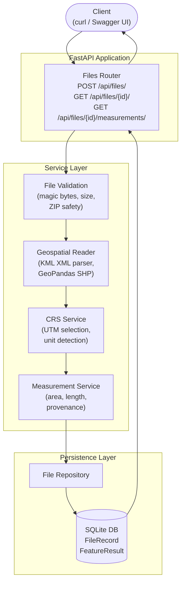
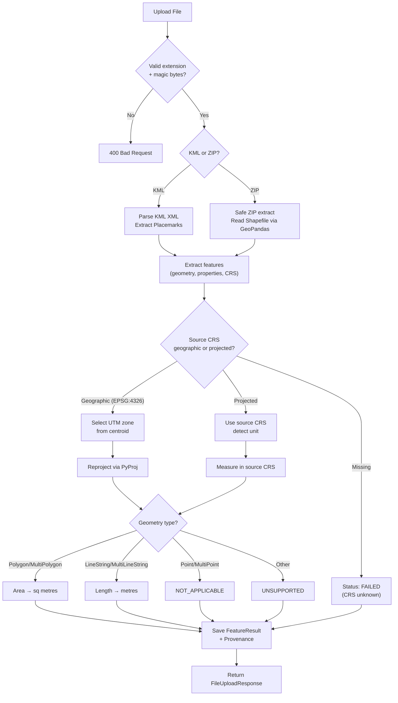

# GeoMeasure

> **Reliable Spatial Measurements. Traceable Geospatial Data.**

GeoMeasure is a geospatial file measurement and validation API built with **FastAPI** and **GeoPandas**. It accepts KML files and zipped Shapefiles, extracts feature geometries, reprojects coordinates to an appropriate projected CRS, and returns accurate area/length measurements with full **Measurement Provenance** — a traceable record of every CRS decision and calculation method used.

*Built as a submission for the Aereo Geospatial File Measurement API assignment.*

---

## Problem Statement

Drone surveying, land-parcel mapping, and GIS workflows routinely produce files in KML and Shapefile formats. Measuring these files correctly is harder than it looks:

- KML files are always in geographic WGS 84 (EPSG:4326) — calculating area in degrees gives meaningless results.
- Shapefiles may arrive in any CRS, projected or geographic, with or without a `.prj` file.
- A single file may contain mixed geometry types (polygons, lines, and points).
- Individual features may have invalid geometries without invalidating the whole dataset.

GeoMeasure solves this cleanly: upload a file, get back metre-based measurements with a full explanation of how each value was calculated.

---

## Relevance to Drone Surveying

| Use Case | How GeoMeasure Helps |
|---|---|
| Land-parcel surveys | Calculates parcel area in sq metres and hectares |
| Infrastructure planning | Measures road/pipeline lengths in metres |
| Mining surveys | Processes projected CRS data without manual conversion |
| Flight planning | Reads KML exports from ground control software |
| GIS QA pipelines | Validates CRS, geometry integrity, and attribute completeness |

---

## Features

- ✅ Upload **KML** and **zipped Shapefile** files
- ✅ **Polygon / MultiPolygon** → area in sq metres (with hectare conversion)
- ✅ **LineString / MultiLineString** → length in metres
- ✅ **Point / MultiPoint** → preserved with NOT_APPLICABLE status
- ✅ **Automatic CRS reprojection** — geographic datasets are projected to the appropriate UTM zone before measurement
- ✅ **Measurement Provenance** — every feature records source CRS, measurement CRS, and a plain-English method description
- ✅ **File-level validation summary** — missing CRS, invalid geometries, unsupported types
- ✅ **Safe ZIP handling** — path-traversal protection, size limits, magic-byte validation
- ✅ **Persistent results** — SQLite storage, results survive application restarts
- ✅ **85 automated tests** with tolerance-based numerical assertions
- ✅ **Swagger UI** and **ReDoc** auto-generated documentation

---

## Technology Stack

| Component | Library |
|---|---|
| API framework | FastAPI 0.116 |
| ASGI server | Uvicorn |
| Geospatial I/O | GeoPandas 1.2 (pyogrio backend) |
| Geometry operations | Shapely 2.2 |
| CRS / reprojection | PyProj 3.8 |
| Shapefile I/O | Fiona 1.10 |
| KML parsing | Python `xml.etree.ElementTree` + lxml |
| Validation | Pydantic 2.10 + pydantic-settings |
| Persistence | SQLAlchemy 2.0 + SQLite |
| Testing | pytest 9.1 + FastAPI TestClient + httpx |
| Python | 3.12.6 |

> **KML Note:** The pre-built GeoPandas/GDAL wheel for Windows does not include the KML/LIBKML GDAL driver. GeoMeasure therefore parses KML directly using Python's standard-library XML parser, which handles all geometry types defined in the KML 2.2 specification (Point, LineString, Polygon, MultiGeometry) and all namespace variants.

---

## Architecture



---

## Processing Flow



---

## Project Structure

```
geomeasure/
├── app/
│   ├── main.py                    # FastAPI app, exception handlers, startup
│   ├── api/
│   │   └── routes/
│   │       └── files.py           # All 3 API endpoints
│   ├── core/
│   │   ├── config.py              # Settings (pydantic-settings)
│   │   └── exceptions.py          # Typed domain exceptions
│   ├── models/
│   │   ├── database.py            # SQLAlchemy engine + session factory
│   │   └── file_record.py         # FileRecord + FeatureResult ORM models
│   ├── schemas/
│   │   └── files.py               # Pydantic response schemas
│   ├── services/
│   │   ├── file_validation.py     # Upload safety (magic bytes, ZIP, size)
│   │   ├── geospatial_reader.py   # KML XML parser + Shapefile reader
│   │   ├── crs_service.py         # CRS selection + UTM zone logic
│   │   └── measurement_service.py # Area/length calculation + provenance
│   └── repositories/
│       └── file_repository.py     # Database CRUD operations
├── tests/
│   ├── conftest.py                # Fixtures, in-memory DB, sample files
│   ├── test_upload.py             # Upload endpoint tests (19 tests)
│   ├── test_file_information.py   # File info tests (11 tests)
│   ├── test_measurements.py       # Measurement tests (25 tests)
│   ├── test_crs.py                # CRS handling tests (14 tests)
│   └── test_invalid_files.py      # Error handling tests (16 tests)
├── sample_data/
│   └── generate_samples.py        # Creates sample KML + SHP files
├── uploads/                       # Temporary upload directory (gitignored)
├── .env.example                   # Environment variable documentation
├── .gitignore
├── pytest.ini
├── requirements.txt
└── README.md
```

---

## Prerequisites

- Python 3.11 or 3.12 (tested on 3.12.6)
- Git
- Windows PowerShell or Command Prompt

---

## Setup Instructions (Windows / VS Code)

### 1. Clone the repository

```powershell
git clone https://github.com/LonelyDreamer005/GeoMeasure.git
cd GeoMeasure\geomeasure
```

### 2. Create and activate virtual environment

```powershell
python -m venv venv
.\venv\Scripts\activate
```

You should see `(venv)` in your prompt.

### 3. Install dependencies

```powershell
pip install -r requirements.txt
```

> **Note:** GeoPandas on Windows requires binary wheels. The `requirements.txt` uses versions that have pre-built wheels available on PyPI. If installation fails, try installing geopandas first: `pip install geopandas`.

### 4. (Optional) Configure environment

```powershell
Copy-Item .env.example .env
# Edit .env if you want to override any defaults
```

### 5. Start the API server

```powershell
uvicorn app.main:app --reload --port 8000
```

The database file `geomeasure.db` is created automatically on first startup.

### 6. Open the documentation

- **Swagger UI:** http://localhost:8000/docs
- **ReDoc:** http://localhost:8000/redoc
- **Health check:** http://localhost:8000/health

### 7. Generate sample test files

```powershell
python sample_data/generate_samples.py
```

---

## API Endpoints

### POST /api/files/ — Upload and Process

Upload a `.kml` file or a `.zip` containing a Shapefile.

**Request:** `multipart/form-data` with field `file`

**PowerShell example:**
```powershell
$response = Invoke-RestMethod -Uri "http://localhost:8000/api/files/" `
  -Method POST `
  -Form @{ file = Get-Item ".\sample_data\sample_polygon.kml" }
$response | ConvertTo-Json -Depth 5
```

**curl example:**
```bash
curl -X POST "http://localhost:8000/api/files/" \
  -H "accept: application/json" \
  -F "file=@sample_data/sample_polygon.kml"
```

**Response (201 Created):**
```json
{
  "id": "3fa85f64-5717-4562-b3fc-2c963f66afa6",
  "filename": "sample_polygon.kml",
  "file_type": "kml",
  "feature_count": 1,
  "crs": "EPSG:4326",
  "status": "COMPLETED",
  "file_size_bytes": 842,
  "created_at": "2024-01-15T10:30:00Z",
  "validation_summary": {
    "has_issues": false,
    "issues": [],
    "missing_crs": false,
    "invalid_geometry_count": 0,
    "unsupported_geometry_count": 0,
    "failed_measurement_count": 0
  }
}
```

---

### GET /api/files/{id}/ — File Information

**PowerShell:**
```powershell
Invoke-RestMethod "http://localhost:8000/api/files/3fa85f64-5717-4562-b3fc-2c963f66afa6/"
```

**curl:**
```bash
curl "http://localhost:8000/api/files/3fa85f64-5717-4562-b3fc-2c963f66afa6/"
```

**Response (200 OK):**
```json
{
  "id": "3fa85f64-5717-4562-b3fc-2c963f66afa6",
  "filename": "sample_polygon.kml",
  "file_type": "kml",
  "feature_count": 1,
  "crs": "EPSG:4326",
  "status": "COMPLETED",
  "file_size_bytes": 842,
  "created_at": "2024-01-15T10:30:00Z",
  "processed_at": "2024-01-15T10:30:01Z",
  "validation_summary": { ... },
  "error_detail": null
}
```

Returns **404** with `{"code": "FILE_NOT_FOUND", "message": "..."}` for unknown IDs.

---

### GET /api/files/{id}/measurements/ — Feature Measurements

**PowerShell:**
```powershell
Invoke-RestMethod "http://localhost:8000/api/files/3fa85f64-5717-4562-b3fc-2c963f66afa6/measurements/"
```

**curl:**
```bash
curl "http://localhost:8000/api/files/3fa85f64-5717-4562-b3fc-2c963f66afa6/measurements/"
```

**Response (200 OK):**
```json
{
  "file_id": "3fa85f64-5717-4562-b3fc-2c963f66afa6",
  "filename": "sample_polygon.kml",
  "status": "COMPLETED",
  "source_crs": "EPSG:4326",
  "summary": {
    "total_features": 1,
    "measured": 1,
    "not_applicable": 0,
    "unsupported": 0,
    "failed": 0
  },
  "features": [
    {
      "feature_index": 0,
      "feature_id": "parcel1",
      "geometry_type": "Polygon",
      "properties": {
        "name": "Land Parcel A",
        "parcel_id": "BLR-001",
        "land_use": "agriculture"
      },
      "geometry": {
        "type": "Polygon",
        "coordinates": [[[77.58, 12.97], [77.6, 12.97], [77.6, 12.99], [77.58, 12.99], [77.58, 12.97]]]
      },
      "measurement_type": "area",
      "measurement_value": 4847232.1234,
      "measurement_unit": "sq_m",
      "measurement_status": "MEASURED",
      "provenance": {
        "source_crs": "EPSG:4326",
        "measurement_crs": "EPSG:32643",
        "measurement_type": "area",
        "measurement_unit": "sq_m",
        "method_description": "Source CRS 'WGS 84' is geographic (angular units). Geometries were reprojected to UTM zone EPSG:32643 (WGS 84 / UTM zone 43N), selected from the geometry centroid at (77.5900°, 12.9800°). Measurements are in metres (sq metres for area). Raw area: 4847232.1234 metres². Converted to sq metres: 4847232.1234 sq m (484.7232 ha).",
        "status": "MEASURED"
      }
    }
  ]
}
```

---

### GET /health — Health Check

```bash
curl http://localhost:8000/health
```
```json
{
  "status": "healthy",
  "service": "GeoMeasure",
  "version": "1.0.0",
  "tagline": "Reliable Spatial Measurements. Traceable Geospatial Data."
}
```

---

## CRS Selection Strategy

This is the most critical technical requirement. GeoMeasure implements a three-tier strategy:

### Tier 1: Source CRS is already projected
If the source file is in a projected CRS (e.g., EPSG:32644 UTM Zone 44N), measurements are calculated directly without reprojection. The unit is inspected and measurements are converted to metres if needed.

### Tier 2: Source CRS is geographic (e.g., EPSG:4326)
The geometry centroid's longitude/latitude determines the UTM zone:

```
zone = floor((longitude + 180) / 6) + 1
EPSG = 32600 + zone    (Northern hemisphere)
EPSG = 32700 + zone    (Southern hemisphere)
```

UTM is used because it provides metric planar coordinates with < 0.1% distortion for geometry that fits within a 6° zone.

### Tier 3: Geometry spans > 20° longitude
UTM would distort large-area geometries. GeoMeasure falls back to **Web Mercator (EPSG:3857)** and records a warning in the provenance. This is documented as not area-preserving at high latitudes.

### Missing CRS
If no CRS is available, the measurement status is `FAILED`. Feature geometry and attributes are preserved. The validation summary flags this as `missing_crs: true`.

---

## Measurement Units

| Geometry Type | Measurement | Unit | Conversion |
|---|---|---|---|
| Polygon / MultiPolygon | Area | `sq_m` (square metres) | ÷ 10,000 = hectares |
| LineString / MultiLineString | Length | `m` (metres) | — |
| Point / MultiPoint | — | `null` | `NOT_APPLICABLE` |
| GeometryCollection | — | `null` | `UNSUPPORTED` |

---

## Measurement Status Values

| Status | Meaning |
|---|---|
| `MEASURED` | Calculation succeeded; `measurement_value` contains the result |
| `NOT_APPLICABLE` | Geometry type (Point) has no applicable measurement |
| `UNSUPPORTED` | Geometry type is recognised but has no defined measurement rule |
| `FAILED` | An exception occurred, or CRS is missing/invalid; `measurement_value` is `null` |

> Zero (`0.0`) is a valid measurement value. `null` means the measurement could not be performed — never substitute zero for an unknown measurement.

---

## Error Handling

| Scenario | HTTP Status | Error Code |
|---|---|---|
| Unsupported file extension | 400 | `UnsupportedFileTypeError` |
| Empty file | 400 | `EmptyFileError` |
| File exceeds 50 MB limit | 400 | `FileSizeLimitExceededError` |
| Corrupt ZIP archive | 400 | `InvalidZipArchiveError` |
| ZIP path traversal attempt | 400 | `ZipPathTraversalError` |
| ZIP contains no .shp | 400 | `MissingShapefileComponentError` |
| Malformed KML XML | 422 | `KMLParseError` |
| Shapefile cannot be read | 422 | `ShapefileReadError` |
| Unknown file ID | 404 | `FILE_NOT_FOUND` |
| File still processing | 409 | `PROCESSING` |
| File processing failed | 422 | `PROCESSING_FAILED` |

No Python tracebacks or internal paths are returned to clients.

---

## Running Tests

```powershell
# From the geomeasure/ directory
cd geomeasure

# Run all tests
python -m pytest tests/ -v

# Run a specific test file
python -m pytest tests/test_measurements.py -v

# Run with coverage (if pytest-cov is installed)
python -m pytest tests/ --cov=app
```

### Test Results

```
85 passed, 0 failed in ~3.5 seconds
```

| Test File | Tests | Coverage |
|---|---|---|
| test_upload.py | 19 | Upload endpoint, file type detection, rejections |
| test_file_information.py | 11 | File info retrieval, 404 handling |
| test_measurements.py | 25 | Area, length, point, provenance, shapefiles |
| test_crs.py | 14 | CRS selection, UTM zones, reprojection |
| test_invalid_files.py | 16 | Invalid files, path traversal, edge cases |

Numerical tests use explicit tolerance bounds (5% for area, 1% for length) rather than exact floating-point equality.

---

## Important Design Decisions

### Why XML parsing for KML instead of GDAL?
The pre-built GeoPandas wheels for Windows (without a full GDAL build) do not include the KML or LIBKML driver. Rather than requiring users to compile GDAL from source, GeoMeasure parses KML directly using Python's standard-library `xml.etree.ElementTree`. This handles all geometry types in KML 2.2 and all namespace variants without any additional dependencies.

### Why synchronous processing?
The assignment requires a backend API for files up to 50 MB. Synchronous processing keeps the code simple and easy to trace during a technical review. For production-scale use, the processing step could be moved to a background task (Celery, ARQ) and the status endpoint would be polled.

### Why SQLite?
No external database server is required, making setup reproducible on any machine. SQLAlchemy abstracts the database layer, so switching to PostgreSQL would require only a connection string change.

### Why UTM and not another equal-area projection?
UTM provides well-known, well-tested, metre-based coordinates for any location on Earth and is familiar to geospatial practitioners. For very large datasets, an equal-area projection like Mollweide would be more accurate but is less intuitive to explain.

---

## Current Limitations

1. **KML MultiGeometry**: GeometryCollection features are marked UNSUPPORTED. Individual constituent geometries inside a MultiGeometry would need to be measured separately.
2. **Synchronous processing**: Large files (> ~20 MB) may take several seconds to process while the HTTP connection stays open.
3. **No file deletion**: Uploaded metadata and results persist indefinitely in the SQLite database. A cleanup endpoint or TTL policy would be needed for production.
4. **GDAL KML driver**: If you have a full GDAL build with KML support, you can extend the geospatial reader to use GeoPandas for KML as well.
5. **World Mercator fallback**: Area measurements for global datasets use EPSG:3857, which is not equal-area. This is documented in the provenance for each affected feature.

---

## What I Learned

- **CRS is the hardest part of geospatial measurement.** A single wrong assumption (measuring in degrees, ignoring CRS units, trusting the stated extension) produces silently incorrect results.
- **UTM zone selection** is straightforward but requires handling edge cases: geometries spanning multiple zones, southern hemisphere, and geometries with no parseable centroid.
- **FastAPI's dependency injection** makes database session management clean and testable — overriding `get_db` in tests requires no mocking.
- **pytest fixtures** with in-memory SQLite allow full integration tests that run in under 4 seconds without touching the real database.
- **Magic-byte detection** is more reliable than trusting file extensions. A PNG renamed to `.kml` should be rejected — and it is.

---

## Future Scope

- Background task processing (ARQ or Celery) for large files
- File deletion / TTL policy with a `DELETE /api/files/{id}/` endpoint
- Support for GeoJSON and GeoPackage input formats
- Equal-area projection selection for global datasets
- Batch upload (multiple files in one request)
- Conversion endpoint (sq_m → hectares → acres)
- OpenAPI schema export for client generation

---

## GitHub Repository

**Public URL:** https://github.com/LonelyDreamer005/GeoMeasure

```powershell
git clone https://github.com/LonelyDreamer005/GeoMeasure.git
```

---

*GeoMeasure is an independent student project created as a technical assignment. It is not affiliated with or endorsed by Aereo.*
